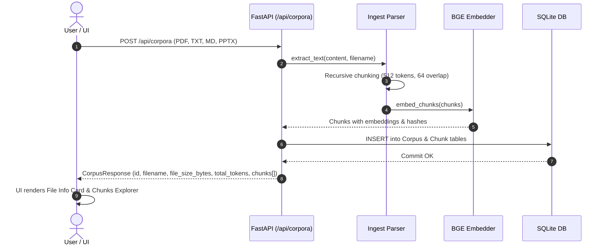
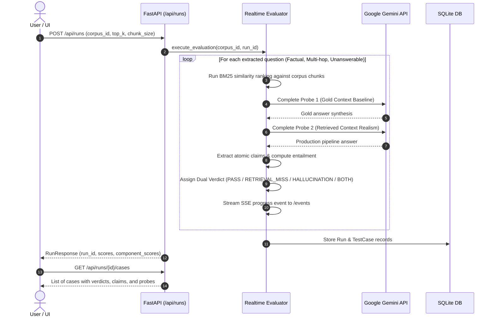
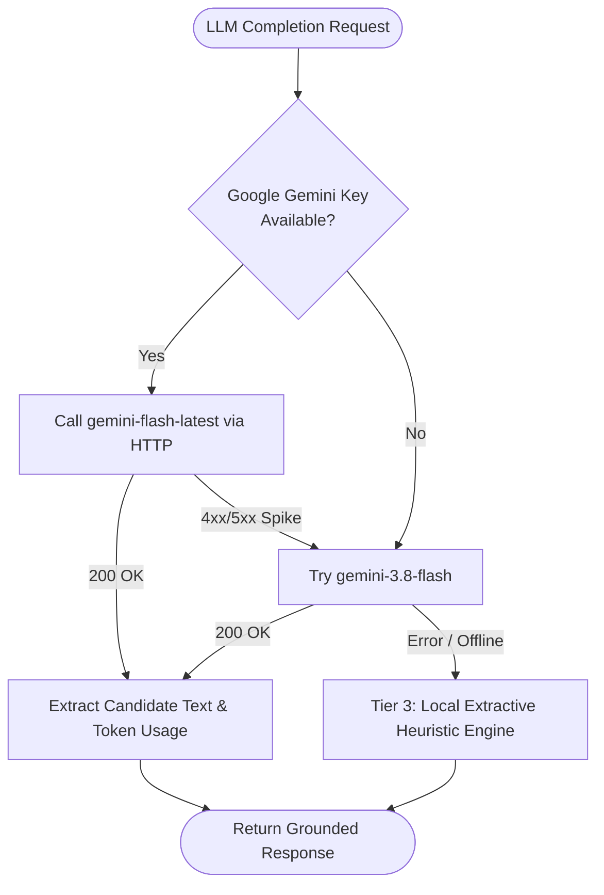

# RAG Doctor — Comprehensive System Documentation & Architectural Specification
**Hackathon Track AI-04: Autonomous RAG Evaluation & Diagnostic Cockpit**

> [!TIP]
> **Main Interactive Architectural Mind Map**: An interactive visual mind map with expand/collapse nodes, dragging, pan & zoom, on-hover description cards, and theme sync is available at [`RAG Doctor mind map.html`](file:///c:/Users/Dell/Desktop/Hackathon/RAG%20Doctor%20mind%20map.html) (or [`index.html`](file:///c:/Users/Dell/Desktop/Hackathon/index.html) / in-app **Map** tab).

---

## 1. Executive Summary & Problem Mission

### 1.1 The Production RAG Dilemma
Retrieval-Augmented Generation (RAG) pipelines in enterprise production degrade silently. Standard end-to-end evaluation metrics (e.g. naive BLEU, ROUGE, or black-box accuracy) conflate two fundamentally distinct failure modes:
1. **Retriever Failure**: The vector index fails to retrieve the correct source passages, meaning even a flawless LLM generator cannot ground its answer.
2. **Generator Hallucination**: The retriever successfully fetches the exact ground-truth passage, but the LLM generator fabricates ungrounded claims, invents citations, or contradicts the evidence.

When production answers are wrong, engineering teams waste weeks fine-tuning embedding models when the LLM generator was hallucinating, or redesigning prompt templates when the retriever missed the chunks.

### 1.2 The RAG Doctor Solution
**RAG Doctor** is an autonomous evaluation and diagnostic cockpit that **decouples retriever evaluation from generator evaluation**. By testing both components in controlled isolation using **4 Counterfactual Stress Probes**, the system categorizes every query into one of **4 Deterministic Dual Verdicts**, benchmarks judge confidence using **Cohen's Kappa ($\kappa \ge 0.85$) against synthetic mutations**, and operates as both a high-performance **pywebview desktop software** and web cockpit with a live 0.5s replay cache.

---

## 2. Core Architectural Breakthroughs

```
                                  [ User Query & Document ]
                                              │
                      ┌───────────────────────┴───────────────────────┐
                      ▼                                               ▼
         ┌─────────────────────────┐                     ┌─────────────────────────┐
         │ 1. Retriever Isolation  │                     │  2. Generator Isolation │
         │   • Precision@k, Recall │                     │    • 4 Stress Probes    │
         │   • Hit Rate, ContextRel│                     │    • Claim Grounding    │
         └────────────┬────────────┘                     └────────────┬────────────┘
                      │                                               │
                      └───────────────────────┬───────────────────────┘
                                              ▼
                             ┌─────────────────────────────────┐
                             │  3. The 4 Dual Verdicts Matrix  │
                             │  PASS | RETRIEVAL_MISS |        │
                             │  HALLUCINATION | BOTH_FAILED    │
                             └────────────────┬────────────────┘
                                              ▼
                             ┌─────────────────────────────────┐
                             │  4. Prescribed Remediation Fix  │
                             │  (Top-k, Hybrid BM25, Prompt)   │
                             └─────────────────────────────────┘
```

### 2.1 Decoupled Evaluation Methodology
- **Retriever Testing**: Evaluated independently against curated ground-truth document spans using BM25 and dense vector similarity ($Hit@k$, $MRR$, $Context Relevance$).
- **Generator Testing**: Tested using controlled context streams (Gold Reference Context vs. Retrieved Context vs. Injected Distractors vs. Empty Context) to quantify pure reasoning fidelity without retrieval noise.

### 2.2 The 4 Dual Verdicts Truth Matrix

| Verdict | Retriever State | Generator State | Root Cause & Diagnosis | Recommended Engineering Action |
|---|---|---|---|---|
| **`PASS`** | **HIT** (Gold context ranked in top-k) | **FAITHFUL** (100% claims grounded in context) | Nominal operation. Both components succeeded. | Maintain automated regression guardrails. |
| **`RETRIEVAL_MISS`** | **MISS** (Gold chunk absent or rank $>k$) | **ABSTAINED / DEGRADED** (Missing context) | Retriever failed to locate evidence. Generator could not answer. | Tune chunk size (512 $\rightarrow$ 256), increase top-k cutoff, enable BM25 hybrid search. |
| **`HALLUCINATION`** | **HIT** (Gold chunk present in context) | **UNFAITHFUL** (Fabricated or contradicted claims) | LLM generator ignored available facts or injected parametric memory. | Set `temperature=0.0`, enforce strict JSON schema, add chain-of-thought citation constraints. |
| **`BOTH_FAILED`** | **MISS** (Distractor chunks fetched) | **UNFAITHFUL / CONFABULATED** (False answer) | Catastrophic failure. Retriever failed AND generator guessed rather than abstaining. | Enforce strict parametric abstention prompt; re-index vector database. |

### 2.3 The 4 Counterfactual Stress Probes
1. **Probe 1: Gold Context Baseline**: Feeds only verified ground-truth reference excerpts directly to the generator, completely bypassing the retriever. Proves whether the generator is intrinsically capable of synthesizing the correct answer.
2. **Probe 2: Retrieved Context (Pipeline Realism)**: Feeds live vector top-k retrieved chunks. Measures production in-situ performance and quantifies retrieval penalty ($P_1 - P_2$).
3. **Probe 3: Noise Distractor Injection**: Injects 2–3 adversarial distractor chunks alongside gold context. Tests generator attention sink stability and distractor resistance.
4. **Probe 4: Parametric Abstention / Hallucination Trigger**: Withholds all supporting context for an out-of-domain query. Verifies whether the generator admits "Insufficient context" or confabulates.

### 2.4 Judge Calibration & Nyquist Verification
- **Synthetic Fault Injections**: Systematically injects 4 mutation types into ground truth:
  - *Entity Swap*: Substitutes named entities with plausible false entities.
  - *Negation Inversion*: Inserts "not", "fails to", or "never" to invert factual truth.
  - *Numeric Scrambling*: Distorts metrics, percentages, dates, and chunk sizes by $\pm 20\text{--}50\%$.
  - *Citation Shuffling*: Misattributes truthful statements to wrong chunk IDs.
- **Cohen's Kappa ($\kappa$) Metric**: Benchmarks the LLM Judge against known synthetic truth:
  $$\kappa = \frac{P_o - P_e}{1 - P_e}$$
  - $\kappa \ge 0.85$: **Production Certified** (Zero human oversight needed).
  - $0.70 \le \kappa < 0.85$: **Supervised** (Flagged for human-in-the-loop review).
  - $\kappa < 0.70$: **Uncalibrated** (Triggers automated fallback).

---

## 3. Directory & File Dictionary

```
Hackathon/
├── backend/                       # FastAPI Server & Python Evaluation Engine
│   ├── pyproject.toml             # uv / PEP 621 package metadata & dependencies
│   ├── uv.lock                    # Locked dependency graph (Python 3.14+)
│   ├── .env                       # Local environment variables (Gemini Key, Mock)
│   ├── .env.example               # Template environment configuration
│   ├── src/
│   │   └── ragdoctor/
│   │       ├── __init__.py        # Package initializer
│   │       ├── config.py          # Pydantic Settings, env aliases, default models
│   │       ├── api/
│   │       │   ├── main.py        # FastAPI ASGI app entry, CORS, lifespan, SPA static mount
│   │       │   ├── routes.py      # REST endpoints (/corpora, /runs, /cases, /validation, /query)
│   │       │   └── schemas.py     # Pydantic v2 request/response contracts
│   │       ├── evaluator/
│   │       │   └── realtime.py    # Dynamic multi-format evaluator, probe runner, SSE stream
│   │       ├── ingest/
│   │       │   ├── parser.py      # Multi-format extractors (PDF, TXT, MD, PPTX) & recursive chunker
│   │       │   └── embedder.py    # BAAI/bge-small-en-v1.5 dense vector embedder
│   │       ├── llm/
│   │       │   └── client.py      # Multi-tier LLM client with Google Gemini API & heuristic fallback
│   │       ├── diagnosis/
│   │       │   ├── matrix.py      # 4-verdict decision matrix classification
│   │       │   └── repair.py      # Prescriptive remediation engine
│   │       ├── scoring/
│   │       │   ├── metrics.py     # Context relevance, faithfulness, accuracy scoring
│   │       │   └── calibration.py # Cohen's Kappa, confusion matrix calculation
│   │       ├── validation/
│   │       │   ├── synthetic.py   # Synthetic mutation generator (entity swap, negation, etc.)
│   │       │   └── nyquist.py     # Wilson score confidence interval statistical verification
│   │       ├── store/
│   │       │   ├── models.py      # SQLModel/SQLAlchemy DB schemas (Corpus, Chunk, Run, TestCase)
│   │       │   └── session.py     # Database engine & multi-process SQLite session generator
│   │       ├── rag/
│   │       │   └── pipeline.py    # BM25 + dense hybrid retrieval pipeline
│   │       ├── mock/
│   │       │   └── loader.py      # Static contract fixture loader for offline demo replay
│   │       ├── prompts/           # Evaluation prompt templates
│   │       └── testgen/           # Automated test-case question generator
│   └── tests/
│       ├── test_api_mock.py       # API route endpoint unit tests
│       └── test_scoring_and_verdicts.py # Core diagnostic & metric calculation tests
├── frontend/                      # React 18 + Vite + Tailwind CSS Cockpit
│   ├── package.json               # Node.js dependencies & scripts
│   ├── vite.config.ts             # Vite build & local dev server proxy configuration
│   ├── tsconfig.json              # TypeScript strict configuration
│   ├── dist/                      # Pre-built production SPA bundle (served by FastAPI)
│   └── src/
│       ├── app.tsx                # Main application cockpit & tab navigation controller
│       ├── main.tsx               # DOM entrypoint
│       ├── index.css              # Global design system tokens & glassmorphic styling
│       ├── api/
│       │   ├── client.ts          # Typed API client, normalizers & replay cache
│       │   └── schema.d.ts        # OpenAPI contract types
│       ├── components/
│       │   ├── Badge.tsx          # Semantic status badge (gold, emerald, red, amber, zinc)
│       │   ├── Button.tsx         # Accessible interactive button with icons & variants
│       │   ├── Modal.tsx          # Accessible dialog modal
│       │   └── Skeleton.tsx       # Loading skeleton animation
│       ├── features/
│       │   ├── corpus/
│       │   │   ├── CorpusStub.tsx # Document corpus dropzone, file details & chunks inspector
│       │   │   └── useUpload.ts   # Upload hook managing document ingestion state
│       │   ├── run/
│       │   │   ├── RunConfigStub.tsx # Run execution controls & progress bar
│       │   │   └── useSSEStream.ts   # Server-Sent Events real-time progress subscriber
│       │   ├── cases/
│       │   │   ├── CaseListStub.tsx  # Test case selector with verdict badges & search filter
│       │   │   └── useCaseList.ts    # React Query hook for test cases
│       │   ├── evidence/
│       │   │   ├── EvidenceStub.tsx  # Side-by-side gold vs retrieved evidence viewer
│       │   │   └── useEvidence.ts    # Claim span segmentation & grounding inspector
│       │   ├── scores/
│       │   │   └── ScoresStub.tsx    # Aggregate diagnostic score cards & distribution
│       │   ├── diagnosis/
│       │   │   └── DiagnosisStub.tsx # Selected case failure diagnosis & fix actions
│       │   ├── validation/
│       │   │   └── ValidationView.tsx # Confusion matrix & Cohen Kappa calibration viewer
│       │   ├── query/
│       │   │   └── AdHocQueryModal.tsx # Interactive sandbox for live ad-hoc query testing
│       │   └── explainers/
│       │       ├── ArchitectureExplainer.tsx # Decoupled evaluation & dual verdicts deep-dive
│       │       ├── ProbesExplainer.tsx       # 4 Counterfactual stress probes interactive lab
│       │       ├── CalibrationExplainer.tsx  # Judge calibration & synthetic fault mutations
│       │       └── SpecExplainer.tsx         # AI-04 track specification & deliverables checklist
│       ├── lib/
│       │   └── utils.ts           # Tailwind clsx/twMerge utility
│       └── tests/
│           ├── explainers.test.tsx # Unit tests verifying all explanation pages
│           ├── smoke.test.tsx      # App shell SSR smoke test
│           └── splitIntoSegments.test.ts # Verbatim claim span segmenter tests
├── desktop/
│   └── app.py                     # pywebview native desktop launcher & backend manager
├── contract/
│   ├── schema.json                # OpenAPI specification contract
│   └── fixtures/                  # Deterministic test fixtures (run_summary, run_cases, validation)
├── data/
│   └── ragdoctor.db               # SQLite database with indexed corpora, chunks & runs
├── scripts/
│   ├── smoke_test.py              # End-to-end 8-step smoke test pipeline
│   └── test_realtime_pipeline.py  # Standalone dynamic document ingestion & evaluation test
├── run_desktop.py                 # Cross-platform Python desktop entrypoint
├── run_desktop.bat                # Windows one-click desktop application launcher
└── mindmap.html                   # Interactive visual SVG/HTML mind map of the entire system
```

---

## 4. End-to-End System Workflows

### 4.1 Document Ingestion & Chunking Flow


### 4.2 Dynamic Real-Time Evaluation Flow


### 4.3 3-Tier Multi-LLM Fallback Architecture


---

## 5. API Reference Specification

| Endpoint | Method | Input Parameters | Output Response | Description |
|---|---|---|---|---|
| `/api/corpora` | `POST` | `multipart/form-data`: `file` (`.pdf`, `.txt`, `.md`, `.pptx`) | `CorpusResponse` | Ingests, parses, chunks, and embeds a document in real time. |
| `/api/corpora/{id}` | `GET` | Path: `id` (e.g. `corp_problem_statements`) | `CorpusResponse` | Fetches document metadata, file size, token count, and full chunk array. |
| `/api/corpora/{id}/chunks` | `GET` | Path: `id` | `list[ChunkSchema]` | Returns all indexed chunks for that corpus. |
| `/api/runs` | `POST` | JSON: `{ corpus_id, top_k, chunk_size, num_questions }` | `RunResponse` | Triggers a real-time decoupled evaluation run over the corpus. |
| `/api/runs/{id}` | `GET` | Path: `id` | `RunResponse` | Fetches run score card ($CR$, $GF$, $GA$), status, and manifest. |
| `/api/runs/{id}/cases` | `GET` | Path: `id` | `list[CaseResponse]` | Returns all evaluated test cases with dual verdicts, claims, and probes. |
| `/api/cases/{id}` | `GET` | Path: `id` | `CaseResponse` | Detailed case inspection with gold chunks, retrieved chunks, and fix actions. |
| `/api/runs/{id}/events` | `GET` | Path: `id` | `text/event-stream` (SSE) | Real-time Server-Sent Events progress stream (0–100%). |
| `/api/runs/{id}/validation` | `GET` | Path: `id` | `ValidationResponse` | Confusion matrix and Cohen's Kappa ($\kappa$) calibration report. |
| `/api/runs/{id}/report` | `GET` | Path: `id` | `text/html` | Formatted standalone HTML diagnostic report. |
| `/api/runs/{id}/compare` | `POST` | JSON: `{ baseline_run_id }` | `CompareResponse` | Delta comparison against another baseline evaluation run. |
| `/api/query` | `POST` | JSON: `{ corpus_id, question, top_k }` | `QueryResponse` | Ad-hoc query sandbox returning retrieved chunks, answer, and scores. |

---

## 6. How to Run & Deploy

### 6.1 Native Windows Desktop Software (`pywebview`)
```cmd
# Double click the batch launcher or run in terminal:
.\run_desktop.bat

# Or launch directly with python:
python run_desktop.py
```
*Note: This automatically launches the backend server and opens a high-performance, native 1440x900 Windows WebView2 application window.*

### 6.2 Browser / Web Mode
1. **Start Backend Server**:
   ```powershell
   cd backend
   uv run uvicorn ragdoctor.api.main:app --host 127.0.0.1 --port 8000
   ```
2. **Start Frontend Dev Server**:
   ```powershell
   cd frontend
   npm run dev -- --host 127.0.0.1 --port 5173
   ```
3. Open `http://localhost:5173` or `http://localhost:8000` (FastAPI serves the built SPA).

### 6.3 Automated Test Suite
- **Backend Unit & Diagnostic Tests**:
  ```powershell
  cd backend
  uv run pytest
  ```
  *(23 tests passing)*
- **Frontend Test Suite**:
  ```powershell
  cd frontend
  npm test
  ```
  *(15 tests passing)*
- **End-to-End Smoke Test Pipeline**:
  ```powershell
  uv run python scripts/smoke_test.py
  ```
  *(All 8 checks passing)*
